<p align="center">
  
</p>

<p align="center">
  <a href="#download"><b>Download for Windows</b></a>
  &nbsp;&nbsp;·&nbsp;&nbsp;
  <a href="#download"><b>Download for macOS</b></a>
  &nbsp;&nbsp;·&nbsp;&nbsp;
  <a href="#under-the-hood"><b>Explore the source</b></a>
</p>

<p align="center">
  Free and open source (MIT) &nbsp;·&nbsp; Windows 10 / 11 and macOS 12 or later &nbsp;·&nbsp; Never connects to the internet
</p>

<br>

<p align="center">
  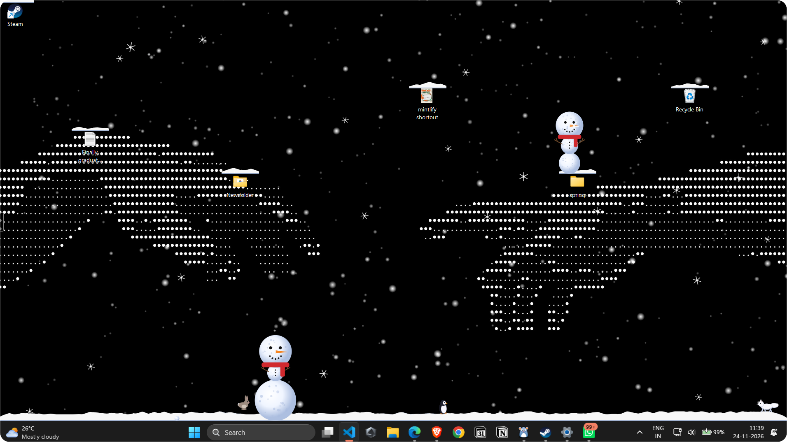
</p>
<p align="center"><sub>A real Windows desktop, a few minutes after starting the app.</sub></p>

<p align="center"></p>

## Your desktop doesn't have to be boring

You spend most of the day looking at the same desktop. Desktop Snowfall adds a little life to it: snow drifts down, settles on top of your windows and icons, and slides off when you move them. Leave it alone and it's a calm winter scene. Get curious and it plays along: the snow rolls into snowballs, the snowballs stack into snowmen, and every now and then a penguin wanders by.

It stays out of your way. Clicks go straight through to your apps (except right on a snowball), it never takes the focus, it hides during fullscreen videos and games, and it pauses when your screen is locked. No accounts, no network, nothing to set up.

<p align="center"></p>

## A tiny winter world

<table>
  <tr>
    <td width="50%" valign="top">
      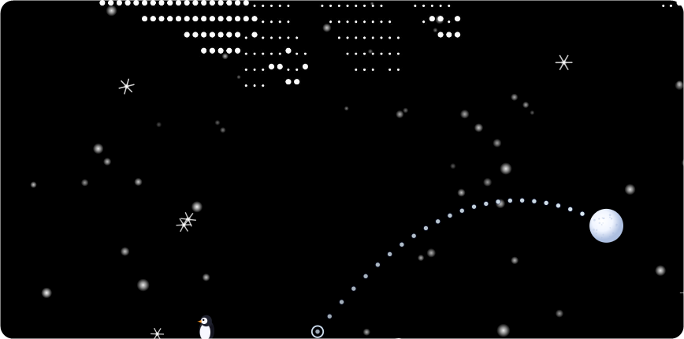
      <p><b>Roll it, carry it, throw it.</b> Slide the mouse sideways over snow and a snowball starts rolling and growing. Pick it up, flick, and let go. Hold <kbd>Shift</kbd> to aim like a slingshot; the dotted line shows where it lands.</p>
    </td>
    <td width="50%" valign="top">
      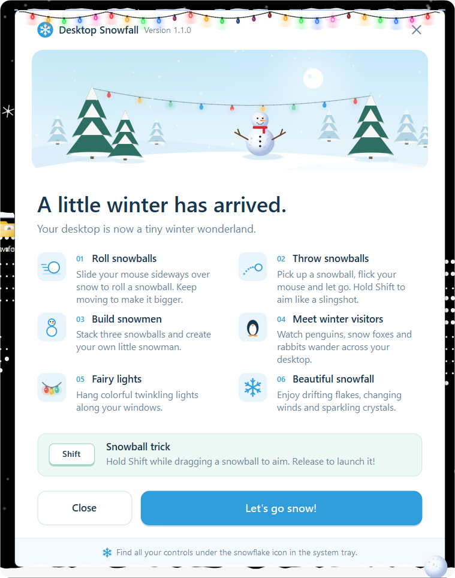
      <p><b>A warm welcome.</b> The first time it opens, a little window shows the main tricks. You can bring it back any time from <b>How to Play</b> in the menu.</p>
    </td>
  </tr>
</table>

<p align="center">
  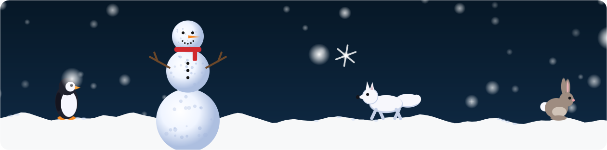
</p>
<p align="center"><sub>The cast, drawn by the app's own renderer: a snowman you built, and three visitors that drop by on Windows.</sub></p>

<p align="center"></p>

## What it can do

### Snowfall
Three layers of flakes (near, middle and far) drift down on a gentle breeze. Pick **Light**, **Medium** or **Heavy** snow. On Windows, gusts of wind sweep through every 25 to 70 seconds, some of the near flakes are slowly turning six-armed crystals, and a few sparkle now and then.

### Snow that piles up
Snow settles on top of your windows (only where nothing covers them), along the bottom of the screen, and on the **taskbar** (Windows) or the **Dock** (Mac). On Windows it also gathers on your **desktop icons**, and the taskbar always keeps a few inches, even while a maximized browser fills the screen. Drag a window and its snow flies off: the faster you drag, the farther it goes. Close a window and its snow falls.

### Snowballs with weight
Roll a snowball just by moving the mouse sideways over snow; it picks up snow and grows as it goes. On Windows they really behave like snow:

- **Size modes:** Normal, Large, Giant, or Experimental, always kept to a small share of your screen
- **Weight:** big balls are slow to get going and keep rolling after you let go
- **Collisions:** a big ball knocks a small one flying, and a hit travels down a row of balls, with a burst of powder
- **Throwing:** flick and let go, or hold <kbd>Shift</kbd> to aim, with a dotted flight path
- **Trails:** rolling leaves soft dents in the snow that slowly fade
- **Break it:** right-click a snowball and it bursts into powder

### Snowmen
Stack three snowballs and they become a snowman with eyes, a carrot nose, a smile, a red scarf, buttons and stick arms. On Windows a snowman has a life of its own: knock it and it wobbles, hit it harder and the carrot nose goes flying, or bowl it over with a big fast snowball.

### Winter visitors (Windows)
Penguins, snow foxes and rabbits wander along the bottom of the screen, leave footprints, and walk *behind* your windows, never over them. Each has its own personality: the penguin slips, sits down and kicks snowballs; the fox jumps over small snowballs and chases rolling ones; the rabbit hops, listens and bolts. Hit one with a snowball and it reacts: the penguin tumbles, slides on its belly, and sometimes throws one back.

<p align="center"></p>

## Fairy lights

Switch them on and a string of twinkling bulbs swings into place along the top of every window, lighting up one by one. On Windows they're glass bulbs with a bright center, a soft glow and a pool of colored light; they sway in the wind, swing when you move a window, and catch a little snow on the wire.

Six color sets, each rendered here by the app itself:

<table>
  <tr>
    <td width="50%">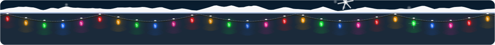<br><sub><b>Classic Christmas</b></sub></td>
    <td width="50%">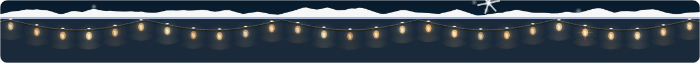<br><sub><b>Warm White</b></sub></td>
  </tr>
  <tr>
    <td>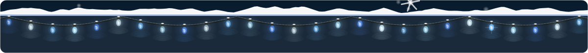<br><sub><b>Arctic Blue</b></sub></td>
    <td>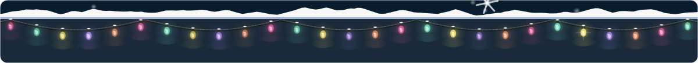<br><sub><b>Candy Colors</b></sub></td>
  </tr>
  <tr>
    <td>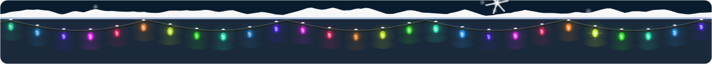<br><sub><b>Rainbow</b> (the colors slowly drift along the string)</sub></td>
    <td>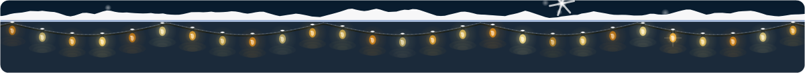<br><sub><b>Golden Christmas</b></sub></td>
  </tr>
</table>

And six ways to twinkle: **Sparkle on & off** (with little star glints), **Gentle twinkle**, **Slow breathing**, **Cascade**, **Alternating** and **Festive sparkle**. Every pattern fades smoothly; nothing flickers.

<p align="center">
  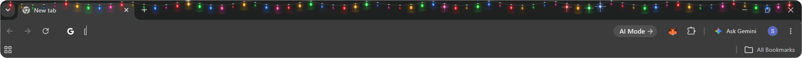
</p>
<p align="center"><sub>Lights along the top of a browser window. Pick colors and patterns under <b>❄ → Light style</b> (Windows); on the Mac the lights come in one classic style.</sub></p>

<p align="center"></p>

## How to play

| | |
|---|---|
| **Start the snow** | Just open the app. A ❄ appears in the system tray (Windows, bottom right, maybe behind the **^**) or the menu bar (Mac). Everything else lives in that menu |
| **Roll a snowball** | Slide the mouse sideways over snow, on a window, the taskbar or Dock, or the ground. No clicking |
| **Carry it** | Hold the left mouse button on a snowball and drag |
| **Throw it** (Windows) | While carrying it, flick the mouse and let go |
| **Aim it** (Windows) | While carrying it, hold <kbd>Shift</kbd>, pull the mouse back and let go, like a slingshot |
| **Build a snowman** | Set a snowball down right on top of another, then a third on top |
| **Break a snowball** (Windows) | Right-click it |
| **Invite a visitor** (Windows) | ❄ → **Visitors** → **Invite one now**, or switch each animal on or off |
| **Hang the lights** | ❄ → **Fairy Lights** (on the Mac you can also press <kbd>L</kbd> with the menu open). Colors and patterns: ❄ → **Light style** (Windows) |
| **Forgot something?** | ❄ → **How to Play** |

On Windows the ❄ menu also has the snow amount, wind gusts, crystal flakes, snow on desktop icons, snowball size and count, trails, visitors, performance (smooth 60 fps or battery saver 30 fps), **Start with Windows**, and **Reset all settings**. Your choices are remembered.

<p align="center"></p>

## Windows and macOS

Desktop Snowfall is one project with two native apps: a C# app for Windows and a Swift app for the Mac. The Windows version is further along today. Here's an honest comparison of the highlights (the full list is in [FEATURES.md](FEATURES.md)):

| | Windows | macOS |
|---|:---:|:---:|
| Three layers of snowfall, Light / Medium / Heavy | ✓ | ✓ |
| Snow on window tops, the screen bottom, dragging windows sends it flying | ✓ | ✓ |
| Snow on the taskbar / Dock | taskbar | Dock (needs Accessibility permission) |
| Snow on desktop icons | ✓ | – |
| Wind gusts, crystal and sparkling flakes | ✓ | – |
| Roll, push and carry snowballs, build snowmen | ✓ | ✓ |
| Snowball weight, collisions, trails, size modes | ✓ | – |
| Throwing and Shift-aiming | ✓ | – |
| Snowmen that wobble, lose their nose and fall over | ✓ | – |
| Penguins, snow foxes and rabbits | ✓ | – |
| Fairy lights | six color sets, six patterns | one style |
| Snow on every screen | ✓ | main screen only |
| Pauses when locked, hides during fullscreen apps | ✓ | pauses when locked or asleep |
| Welcome window | ✓ | ✓ |
| Start at login, battery saver, remembered settings | ✓ | fairy lights remembered |

<p align="center"></p>

## Download

> **No release has been published yet.** The release pipeline is ready (see [RELEASE.md](RELEASE.md)): when the first version is tagged, the files below will appear on the [Releases page](https://github.com/mugenkyou/desktopsnowfall/releases). Until then, building it yourself takes two commands (below).

### Windows

Requirements: Windows 10 or 11, 64-bit (x64 or Arm). Nothing else to install.

- **`desktopsnowfall-setup-x64-v….exe`**: installs just for your account (no administrator needed), adds a Start menu entry, can start the snow with Windows, and uninstalls from **Settings → Apps**
- **`desktopsnowfall-win-x64-portable-v….zip`** or **`win-arm64`**: a single small program, nothing to install. Unzip it anywhere and double-click

The builds aren't code-signed yet, so Windows may say "Windows protected your PC": click **More info → Run anyway**. Every release lists SHA-256 checksums in `SHA256SUMS.txt`.

### macOS

Requirements: macOS 12 or later, Apple silicon or Intel (one universal app).

1. Download **`desktopsnowfall-mac-v….zip`** from the [Releases page](https://github.com/mugenkyou/desktopsnowfall/releases) (not the "Source code" files)
2. Unzip it and drag **desktopsnowfall** into your Applications folder
3. Open it. The first time, macOS says it can't open the app: click **Done**, go to **System Settings → Privacy & Security**, scroll down and click **Open Anyway**. You only do this once
4. For snow on the Dock, allow **desktopsnowfall** in **System Settings → Privacy & Security → Accessibility**, then restart the app

macOS blocks it at first because it isn't signed with a paid Apple Developer account yet. The app never connects to the internet, and all of its code is in this repository.

### Build it yourself

**Windows** needs the [.NET 8 SDK](https://dotnet.microsoft.com/download) (`winget install Microsoft.DotNet.SDK.8`):

```sh
git clone https://github.com/mugenkyou/desktopsnowfall.git
cd desktopsnowfall/windows
dotnet run -c Release
```

**macOS** needs the Xcode command line tools (`xcode-select --install`):

```sh
git clone https://github.com/mugenkyou/desktopsnowfall.git
cd desktopsnowfall
zsh build.sh            # build and run
zsh make_app.sh 1.0     # or package a double-clickable .app into dist/
```

When you run it with `build.sh`, the Dock permission goes to **Terminal** instead of the app.

<p align="center"></p>

## Roadmap

**Done**
- Snow on every screen, with screens added or removed while running (Windows)
- Battery-aware rendering: a 30 fps battery saver, automatic 30 fps on slow machines, and no drawing while the screen is locked, the display is off or a fullscreen app is in front (Windows)
- Start with Windows, and every setting remembered between launches (Windows)
- A per-user installer and portable builds, produced automatically by the release workflow
- Snowball physics, snowmen that react, and visitors with personalities (Windows)
- A welcome window on first launch (both)

**In progress**
- Bringing the Mac up to the Windows feature set: throwing, visitors, snowball weight, light styles, gusts
- The first published release

**Planned**
- More realistic snow and soft environmental lighting
- Richer interactions between the animals and the things around them
- Snow on every screen on the Mac
- Custom themes, and more settings remembered on the Mac
- Start at login on the Mac
- Signed and notarized builds, so no security warnings on first launch
- Automatic updates

<p align="center"></p>

## Under the hood

Both apps avoid extra packages on purpose: no game engine, no Electron, no NuGet or Swift packages. Every flake, snowball, animal and bulb is drawn in code.

**macOS: [`desktopsnowfall.swift`](desktopsnowfall.swift).** One Swift file using AppKit and SpriteKit. A transparent, borderless panel floats above your windows and lets the mouse through except over a snowball. Window positions come from `CGWindowListCopyWindowInfo` 30 times a second; the Dock's position comes from the Accessibility API. The welcome window is SwiftUI.

**Windows: [`windows/Program.cs`](windows/Program.cs) and [`windows/Welcome.cs`](windows/Welcome.cs).** C# on .NET 8 talking straight to Win32, with no UI framework. Each screen gets one transparent, click-through, always-on-top layered window; the app draws every frame itself with a small software renderer (anti-aliased shapes from signed distance functions, into a premultiplied BGRA bitmap) and hands it to Windows with `UpdateLayeredWindow`. Drawing a frame allocates no memory.

**The snow.** Every surface (a window top, a desktop icon, the taskbar, the bottom of each screen) is a height map with one column every 3 pixels. Landing flakes add to the columns around them, steep slopes slump sideways, and columns hidden behind another window are left empty. The wind is a few slow sine waves plus an occasional gust that swells and dies down.

**The physics.** A snowball's mass grows with its area. The mouse pulls the ball it rolls like a critically damped spring, so small balls follow at once and heavy ones lag and coast. Balls on the same surface collide with real momentum exchange and a little bounce (snow is soft). A stacked snowman rocks like a damped spring and falls apart past a set lean. Thrown balls follow gravity and burst on the first thing they meet.

**The visitors.** Each animal is a small state machine: wandering, pausing to look around, its own habits, and its reactions to being hit, each with its own timing and footprints.

**Testing.** The Windows simulation and renderer run headless in [`windows/tests`](windows/tests): about 150 checks covering snow, physics, snowmen, visitors, lights, multiple screens, the welcome window, frame time and zero allocations per frame. CI runs them on every push and also compiles, packages and launch-tests the Mac app on a real Mac:

```sh
cd windows/tests
dotnet run -c Release
```

**Make it yours.** The settings sit at the top of each app (`Cfg`): how many flakes fall, how fast, how tall the piles get, how big a snowball can grow. Change a number and build again.

<p align="center"></p>

## Troubleshooting

- **I don't see the ❄ icon (Windows).** Click the **^** next to the clock, and drag the ❄ onto the taskbar to keep it there
- **The snow disappeared (Windows).** Is a fullscreen video or game in front? The snow comes back when you leave fullscreen. Also check ❄ → **Pause snow**
- **No snow on the Dock (Mac).** Allow the app (or **Terminal**, if you run `build.sh`) under **Privacy & Security → Accessibility**, then restart it
- **It feels heavy on an old laptop.** ❄ → Performance → **Battery saver**, or Snow → **Light**
- **Something's stuck.** ❄ → **Clear snow**, or **Reset all settings** (Windows)
- **See the welcome window again.** ❄ → **How to Play**. To see it exactly as on a first launch, start the app with `--reset-welcome`

**Known limitations:** the Mac only snows on the main screen; with different display scaling per screen, Windows sizes the snow for the main screen; the taskbar or Dock only gets snow when it sits at the bottom of the screen; neither app is code-signed yet; the Experimental snowball size can only be changed in the registry (`HKCU\Software\desktopsnowfall\ExperimentalMaxRadius`).

<p align="center"></p>

## Contributing

Ideas, bug reports and pull requests are all welcome.

- **Found a bug or have an idea?** [Open an issue](https://github.com/mugenkyou/desktopsnowfall/issues). For a bug, say which platform and version, what you did and what you saw; a screenshot helps a lot
- **Want to change something?** [CONTRIBUTING.md](CONTRIBUTING.md) explains the layout, how to build and test on each platform, what CI checks, and the hands-on checklist used before a release
- **Making a release:** [RELEASE.md](RELEASE.md)

## License

[MIT](LICENSE). Use it, change it, share it.

<p align="center"></p>
